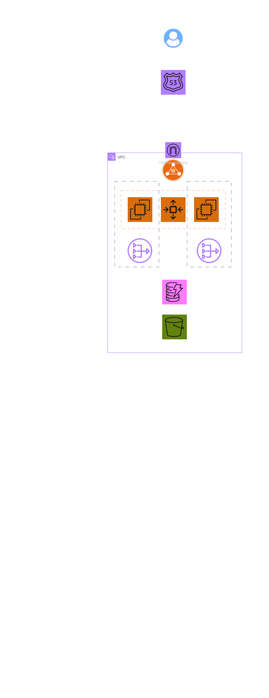

# AWS Multi-AZ High Availability Web Architecture

A highly available web tier deployed manually on AWS (us-east-1) across two Availability Zones, with private compute, per-AZ NAT egress, an internet-facing Application Load Balancer, and an Auto Scaling Group that self-heals on instance failure.

Full console walkthrough with screenshots: [docs/AWS_Deploy.pdf](docs/AWS_Deploy.pdf)

## Architecture Summary

Request path:

    Client -> ALB (public subnets, 2 AZs) -> EC2 targets (private subnets, 2 AZs)

Egress path (patching, package installs):

    EC2 (private subnet) -> NAT Gateway (same AZ) -> Internet Gateway

## Components

- VPC: 10.0.0.0/16 (HP-Project-VPC), DNS resolution enabled
- Subnets (4):
  - Public-Subnet-A: 10.0.1.0/24, us-east-1a (ALB, NAT-A)
  - Public-Subnet-B: 10.0.2.0/24, us-east-1b (ALB, NAT-B)
  - Private-Subnet-A: 10.0.3.0/24, us-east-1a (EC2)
  - Private-Subnet-B: 10.0.4.0/24, us-east-1b (EC2)
- Internet Gateway attached to the VPC
- Route tables:
  - Public: 0.0.0.0/0 -> IGW (associated with both public subnets)
  - Private-A: 0.0.0.0/0 -> NAT-A
  - Private-B: 0.0.0.0/0 -> NAT-B
  - One NAT per AZ, so losing one AZ does not break egress in the other
- Security groups (chained, least-privilege ingress):
  - ALB-SG: inbound TCP 80 from 0.0.0.0/0
  - EC2-SG: inbound TCP 80 only from ALB-SG (no direct internet ingress)
- Compute: Launch Template (t3.micro, no SSH key pair) + Auto Scaling Group
  - Min 2 / Desired 2 / Max 4, balanced across both private subnets
- Load balancing: internet-facing ALB, HTTP:80 listener, target group with health checks, registered to the ASG
- Data services provisioned: DynamoDB table (on-demand, partition key `ID`), S3 bucket (versioning enabled)

## High Availability Test

1. Confirmed 2/2 healthy targets across us-east-1a and us-east-1b.
2. Manually terminated one instance in us-east-1a.
3. ALB kept serving traffic from the us-east-1b instance (no outage observed).
4. The ASG marked the terminated instance unhealthy and launched a replacement, returning to desired capacity.

Evidence is in the walkthrough PDF (target health, termination, ASG replacement, site still reachable).

## Security Posture

- EC2 instances live in private subnets with no public IPs and no inbound path except from the ALB.
- No SSH key pair; no inbound management port exposed.
- Security group referencing (SG-to-SG) instead of CIDR ranges for the app tier.

## Known Limitations (Honest Scope)

- HTTP only. No TLS listener, no ACM certificate, no HTTP->HTTPS redirect.
- No custom domain. The app was tested via the ALB DNS name; Route 53 was not configured.
- DynamoDB and S3 are provisioned but not integrated with the application: no instance IAM role, no VPC gateway endpoints.
- EC2-SG egress is allow-all (0.0.0.0/0).
- No WAF, no ALB access logs, no VPC Flow Logs, no CloudWatch alarms.
- Single region; no cross-region DR.
- Built manually through the console (not reproducible as code).

## Planned Improvements

- HTTPS via ACM + ALB listener on 443, redirect 80 -> 443
- AWS WAF on the ALB
- IAM instance profile (least privilege) for DynamoDB/S3 access
- VPC gateway endpoints for S3 and DynamoDB (removes NAT dependency for that traffic)
- SSM Session Manager for instance access
- IMDSv2 enforced in the launch template
- Restrict EC2-SG egress to required destinations
- ALB access logs, VPC Flow Logs, CloudWatch alarms and ASG target-tracking scaling policy
- Route 53 alias record with a registered domain
- Rebuild in Terraform

## Teardown

Delete in this order to avoid dependency errors and ongoing cost:

1. Auto Scaling Group (set desired to 0, then delete)
2. ALB, listener, target group
3. NAT Gateways, then release their Elastic IPs
4. Launch Template
5. Security groups
6. Route table associations, route tables, subnets
7. Detach and delete the Internet Gateway
8. VPC
9. DynamoDB table, empty and delete the S3 bucket

## Repository Layout

    .
    ├── README.md
    └── docs/
        ├── architecture.png
        └── AWS_Deploy.pdf
